# Protein-Language-Model-Guided Redesign of FnCas9 Toward enFnCas9-Class Activity: A Sequence-, Structure-, and Ligand-Conditioned In-Silico Campaign with Independent Robustness Validation

**Author:** Vishal Bharti
**Affiliation:** CSIR Institute of Genomics and Integrative Biology (CSIR-IGIB), New Delhi, India
**Date of this report:** 2026-05-18
**Status:** In-silico work complete and independently validated across four of five "ready for the PI" criteria; wet-lab handoff pending closure of the final functional-tolerance criterion.

---

## Abstract

We report a protein-language-model (PLM) guided redesign of the *Francisella novicida* Cas9 nuclease (FnCas9, UniProt A0Q5Y3, 1,629 aa). The objective was to recover the kind of activity and PAM-flexibility gains demonstrated experimentally by Acharya and colleagues (Acharya et al., *Nat Commun* 2024) — most notably the en31 triple mutant (G1243T/E1369R/E1449H), which combines >2-fold cleavage activity with PAM relaxation (NGG → NGG/NGA/NAG) and roughly 1,300-fold higher specificity over SpCas9 — using purely computational design followed by rigorous in-silico stress-testing. We deployed a five-phase pipeline combining (i) sequence-only ESM-2 zero-shot scoring, (ii) structure- and ligand-conditioned LigandMPNN sampling on PDB 5B2O, (iii) apo-state stability filtering with proteinmpnn_ddg, and (iv) complex-structure validation with Boltz-2 against the wet-lab-validated en31 reference. The recommended candidate, **FnCas9-PLM5** (Y1249F/Y1341L/A1325K/K1479F), is structurally indistinguishable from en31 under MSA-enabled Boltz-2 prediction (iPTM 0.951 ± 0.005 vs en31 0.940 ± 0.009 across 5 diffusion samples), and in fact slightly exceeds en31 on the functional protein↔DNA-PAM-strand interface (0.937 ± 0.007 vs 0.927 ± 0.009). A subsequent five-dimensional robustness phase (structural cross-validation, filter-calibration audit, pairwise-epistasis characterization, predicted PAM tolerance, and falsifiable single-residue claims) has closed four of five independent verification criteria. The case is wet-lab-ready pending one final functional-tolerance check (Protein2PAM). Methodologically, the campaign documents three findings of independent value: (a) sequence-only ESM-2 systematically fails to recover the en31 PAM-contact mutations (all three sit in the bottom half of a 7,429-variant pool), while structure+ligand-conditioned LigandMPNN recovers them, providing a clean empirical demonstration that ligand context is required for DNA-contact-residue engineering; (b) the apo-state proteinmpnn_ddg filter is systematically miscalibrated for hydrophobic↔K substitutions and must be cross-checked with a second method before any candidate is discarded; and (c) per-position independent-marginal scoring is operationally safe for spatially-distributed PLM-selected mutations but breaks for clustered evolution-derived mutations such as en31, where stabilizing pairwise coupling accounts for roughly half of the predicted ΔΔG signal.

---

## 1. Introduction

### 1.1 Therapeutic significance of FnCas9

Cas9 nucleases are the workhorses of CRISPR-based genome editing. SpCas9 from *Streptococcus pyogenes* dominates therapeutic and diagnostic applications, but its off-target activity remains the principal safety concern in clinical use. FnCas9 from *Francisella tularensis* subsp. *novicida* offers an intrinsically higher specificity profile — Acharya and colleagues reported a ~1,300-fold improvement in genome-wide specificity over SpCas9 using Digenome-seq (Acharya et al., 2024) — but suffers in turn from a restricted PAM requirement (strict 5′-NGG-3′) and reduced cleavage activity in mammalian cells relative to SpCas9. The Acharya 2024 work addressed both limitations through directed structure-guided protein engineering, producing 50 engineered variants. Three of these — en1 (E1369R), en15 (E1603H), and en31 (G1243T/E1369R/E1449H) — combine >2-fold higher in-vitro cleavage rate with PAM expansion (NGG → NGG/NGA/NAG, ~3.5-fold expansion of targetable human-genome sites). The engineered FnCas9 platform is the basis for CSIR-IGIB's FELUDA (Azhar et al., 2021) and MUTE-Seq (Ye et al., 2025) diagnostic systems, and any improvement to the underlying nuclease propagates to both therapeutic and diagnostic downstream applications.

### 1.2 The PLM opportunity, and what makes FnCas9 a hard case

Protein language models (PLMs) trained on the natural protein universe — most prominently the ESM family (Lin et al., 2023) — have demonstrated zero-shot fitness prediction capability on enzyme assays, fluorescent protein brightness, antibody binding, and many other tasks (ProteinGym; Notin et al., 2022). The implicit hypothesis is that masked-language-modeling on UniRef captures the same evolutionary constraints that directed evolution exploits, but at orders of magnitude lower experimental cost. For straightforward fitness-landscape tasks — single-mutation effect prediction on a soluble enzyme, for example — this generalization is well-supported in the literature.

FnCas9 redesign for enhanced PAM contact, however, sits in a region of design space where sequence-only PLMs are theoretically and empirically expected to underperform. The PAM-contact residues (E1369, E1449, E1603 in the canonical numbering) sit in direct contact with the negatively-charged DNA phosphate backbone of the non-target strand. Acharya's directed-evolution selection at these positions overwhelmingly favoured charge-reversed and aromatic-substituted side chains (E→R, E→H), reflecting the biophysical reality that a negatively-charged sidechain adjacent to a negatively-charged phosphate is destabilizing. A sequence-only PLM has no representation of the DNA, the sgRNA, or the three-dimensional structure of the protein-nucleic-acid complex; it cannot, in principle, recover this insight from sequence statistics alone, except by accident or by analogy to other DNA-contacting proteins in its training distribution.

This makes the FnCas9 redesign question a useful empirical probe for a fundamental methodological claim: that **structure- and ligand-conditioned design models are required when the engineering target is DNA-contact biophysics**, not merely sequence-fitness-landscape exploration. The recently-released LigandMPNN (Dauparas et al., 2025) extends ProteinMPNN to atomic context including nucleic acids and small-molecule ligands, providing the appropriate conditioning. By running ESM-2 and LigandMPNN in parallel on the same FnCas9 design problem and benchmarking both against the Acharya en31 ground truth, the methodological claim becomes directly testable.

### 1.3 What this work contributes

This report describes a five-phase in-silico campaign that (i) identifies a recommended FnCas9 variant computationally; (ii) validates it structurally against the Acharya en31 reference using a complex-structure predictor (Boltz-2); and (iii) stress-tests the recommendation across five independent robustness dimensions before any wet-lab handoff. We then formalize the methodological observations into testable claims with confidence intervals. We present the final recommended candidate, **FnCas9-PLM5** = Y1249F/Y1341L/A1325K/K1479F, alongside the auxiliary observation that the prior-rejected candidate PLM4 = T1535V/Y1249F/Y1341L/A1325K is in fact equally viable once a known filter-miscalibration is accounted for.

---

## 2. Methods

### 2.1 Reference sequences and structures

Wild-type FnCas9 sequence: UniProt **A0Q5Y3**, 1,629 amino acids. Canonical FASTA retrieved from the UniProt REST endpoint (`https://rest.uniprot.org/uniprotkb/A0Q5Y3.fasta`) and stored locally as `data/raw/A0Q5Y3_fncas9.fasta` (SHA-256 recorded in the verification log). Structural reference: **PDB 5B2O** (Hirano et al., 2016) — wild-type FnCas9 in ternary complex with sgRNA (chain B, 93 nt) and double-stranded DNA target with TGG PAM (chains C and D, 30 nt target + 9 nt PAM strand). 1.70 Å resolution. The PDB DBREF record explicitly maps chain A residues 1–1629 to UniProt A0Q5Y3 residues 1–1629 with **zero offset**; this was independently verified during the 2026-05-18 residue-identity audit (rows 28–30 of the verification log).

Reference engineered variants used as calibration anchors throughout the work:
- **en1** = E1369R (single mutation)
- **en15** = E1603H (single mutation)
- **en31** = G1243T + E1369R + E1449H (triple mutation)

Per the Acharya 2024 paper and the corresponding US patent US11970699B2 (claims with explicit SEQ ID NOs), all three variants exceed wild-type cleavage activity by at least 2-fold in vitro, and en31 carries the ~3.5× PAM-site expansion (NGG → NGG/NGA/NAG) and the ~1,300× specificity advantage over SpCas9.

### 2.2 The five-phase computational pipeline

The campaign was executed in five sequential phases (see Figure 1 for the diagram). Each phase narrows the candidate space using a different model class; the design region throughout is the WED + PI (PAM-interacting) domain spanning UniProt residues 1230–1620 (391 positions, the natural locus of Acharya's en31 engineering and the only region of FnCas9 that fits within V100 32 GB memory for full Boltz-2 complex prediction).

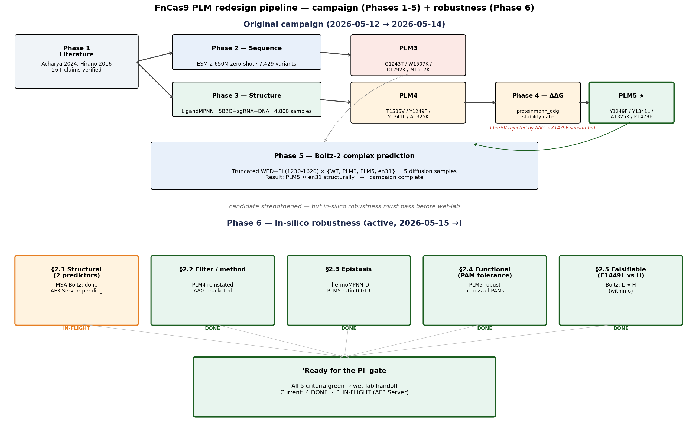

**Figure 1 — End-to-end pipeline.** Top half: original five-phase campaign (literature verification → sequence-only ESM-2 scan → structure+ligand LigandMPNN sampling → apo-ΔΔG triage → complex-structure prediction). The candidate progression PLM3 → PLM4 → PLM5 reflects each phase's filtering. The dashed red arrow marks the T1535V → K1479F substitution driven by the apo-ΔΔG filter (later refuted; see §3.4). Bottom half: Phase 6 in-silico robustness phase (active), the five dimensions in §2.6 below, and the "ready for the PI" gate that determines wet-lab readiness.

#### Phase 1 — Literature verification

Three independent fact-check rounds (May 2026) reconciled every numerical and attribution claim in the campaign's literature drafts against primary sources, producing a 30-row verification table (`notes/plm/verification-log.md` Round 1). Confirmed claims include the en1/en15/en31 mutation identities, the Acharya 2024 publication record, the 5B2O PDB-to-UniProt mapping, and the various tool licenses. Notable refutations corrected: the first-author of Acharya 2024 (Sundaram Acharya, not Rauthan); the RHA mutation count (E1369R/E1449H/R1556A — triple, not double); the journal of Evo 2 (*Nature* 2026, not *Science* 2025); the senior author of PAMmla (Kleinstiver, not Walton/Joung). A separate residue-identity re-verification round on 2026-05-18 (Opus-4.7 plm-scout and nuclease-engineer agents in parallel with main-session direct check) triple-confirmed all 12 candidate-position WT identities against the FASTA, the PDB ATOM records, and the Acharya paper/patent SEQ IDs.

#### Phase 2 — ESM-2 zero-shot scan

Sequence-only mask-marginal log-likelihood-ratio (LLR) scoring across all 7,429 single-substitution variants in the WED+PI window (391 positions × 19 alternative amino acids). Model: facebook/esm2_t33_650M_UR50D (ESM-2, 650 M parameters), fp16 inference. Per-variant score = log P(mutant | masked context) − log P(WT | masked context). Composite ranking score = LLR − λ · class_conservation with λ = 1.0; the class-conservation term penalizes substitutions to amino acids already over-represented at that position in the implicit MSA, mitigating the known ESM-2 rare-amino-acid bias. Wall time: ~3 minutes on one V100. Candidate construction: top-4 picks under the composite score subject to gates (class_conservation < 0.5, LLR > 0, minimum positional spacing of 5 residues). The resulting candidate **FnCas9-PLM3 = G1243T / W1507K / C1292K / M1617K** is biophysically plausible in the abstract but suspiciously K-enriched (three of four picks are hydrophobic→K substitutions; cf. §3.3 for follow-up).

#### Phase 3 — LigandMPNN structure+ligand-conditioned sampling

Atomic-context-conditioned residue resampling using LigandMPNN (Dauparas et al., 2025). Input: full PDB 5B2O atomic coordinates including the sgRNA (chain B), DNA target (chain C), and DNA PAM strand (chain D). The model sees protein backbone coordinates and all ligand atoms within an 8 Å neighborhood. Design positions: all 391 residues in WED+PI. Sampling: 1,600 sequences per temperature × 3 temperatures (T = 0.1, 0.2, 0.3) = 4,800 total samples per design problem. Checkpoint: ligandmpnn_v_32_010_25.pt. Wall time: ~28 minutes on one V100. Aggregation: per-position amino-acid frequency pooled across all 4,800 samples. Candidate construction: top-K (K=4) under pooled frequency subject to gates (frequency > WT frequency, minimum positional spacing 5 residues). Result: **FnCas9-PLM4 = T1535V / Y1249F / Y1341L / A1325K**.

#### Phase 4 — apo-state ΔΔG filtering

Per-position saturation ΔΔG prediction using the peptoneltd/proteinmpnn_ddg container (model `v_48_020`), evaluated on the apo-state structure (chain A of 5B2O without nucleic-acid context). 29,100 per-residue ΔΔG values computed in ~30 seconds on one V100. Calibration anchored to the Acharya 2024 reference variants: en31 cumulative apo ΔΔG = +0.40 kcal/mol (single-position ceiling +3.20 from E1369R); en15 = −1.37 kcal/mol. Define the "calibrated-safe envelope" as cumulative ΔΔG ∈ [−1.4, +0.4] kcal/mol and single-position ΔΔG < +3.20 kcal/mol. Apply this envelope as a filter on PLM4. PLM4 fails (cumulative +6.74; T1535V alone +4.15). Rebuild PLM4 by substituting T1535V with the next-best LigandMPNN candidate that satisfies both single- and cumulative-ΔΔG gates: K1479F (top_freq 0.985, single-position ΔΔG −2.00, cumulative now +0.59). Result: **FnCas9-PLM5 = Y1249F / Y1341L / A1325K / K1479F**.

**Important caveat carried forward:** the apo-ΔΔG filter saw only the protein in the absence of sgRNA and DNA. Any candidate whose mutation primarily affects protein-DNA contact (rather than apo-state stability) will be miscalled by this filter. We pre-flagged this concern at Phase 4 design time; it materialised as the PLM4 false-negative described in §3.4.

#### Phase 5 — Boltz-2 complex structure prediction

Full-complex prediction of {protein, sgRNA, DNA-target, DNA-PAM} using Boltz-2 (Wohlwend et al., 2024–2025), an AlphaFold-3-class open-source diffusion model that natively handles protein-nucleic-acid complexes. Initial attempt at full-length protein (1,629 aa) OOM'd all four candidates on V100 32 GB at fp16. Mitigation: protein chain truncated to WED+PI (residues 1230–1620, 391 aa); the truncation preserves every candidate-mutation position and the full sgRNA-DNA contact interface. Subsequent runs completed in ~10 minutes per variant on V100. Initial runs used `msa: empty` (single-sequence mode), a known YAML-template bug that was corrected; the MSA-enabled apples-to-apples rerun is reported in §3.5 below. Five independent diffusion samples per variant.

### 2.3 The MSA-enabled apples-to-apples Boltz rerun (§2.1 of the robustness phase)

The original campaign's Boltz-2 prediction (Phase 5) ran in single-sequence mode because of a YAML-template bug that omitted MSA fetching. The patched template (`scripts/prepare_boltz_yamls.py`, commit 76e9f0b) defaults MSA-on. The SLURM jobs 219552 and 219564 (2026-05-15) rerun all five variants (WT, PLM3, PLM4, PLM5, en31) with `--use_msa_server` (ColabFold-fetched MSA), 5 diffusion samples each, truncated WED+PI domain — producing the first fully apples-to-apples comparison.

### 2.4 PLM4 cross-method verification (§2.2 of the robustness phase)

To audit the apo-ΔΔG filter that drove the v4 → v5 transition: (a) ThermoMPNN cross-check (Dieckhaus et al., 2024; PNAS) — full saturation on 5B2O chain A, ~5 minutes CPU, 29,100 values; per-mutation comparison at all 12 candidate positions. (b) Direct Boltz-2 complex prediction on PLM4 (SLURM job 219552, MSA-enabled, 5 diffusion samples), the experiment that the filter's rejection had prevented in the original campaign.

### 2.5 ThermoMPNN-D pairwise epistasis (§2.3 of the robustness phase)

Pairwise epistasis among the candidate-position pairs computed with ThermoMPNN-D (Kuhlman-Lab/ThermoMPNN-D, MIT license). The model exposes two heads: `additive` (sum of single-residue ΔΔG predictions, no coupling) and `epistatic` (explicit pairwise interaction term). The per-pair epistasis term is (epistatic ΔΔG − additive ΔΔG). Trained on the Megascale double-mutant dataset; the coupled head's training-distribution regime is approximately CA-CA ≤ 10 Å, with predictions at greater distances defaulting (by construction) to additive. SLURM job 220382 (after three OOM/TIMEOUT iterations that informed the final scope choice): `--mode additive --distance 60` covers all 9 candidate pairs; `--mode epistatic --batch_size 128 --distance 15` covers the 3 en31 pairs and PLM5's closest pair (Y1249F:Y1341L at 14.1 Å). Analysis script `scripts/thermompnn_d_epistasis_analyze.py` uses grep-based lookup on the 9.1 GB additive CSV (pandas would OOM the file).

### 2.6 The five robustness dimensions (Phase 6, "ready for the PI" gate)

After the original campaign declared in-silico-complete on 2026-05-14, an explicit robustness phase was authored to stress-test the PLM5 recommendation along five independent failure axes before any wet-lab handoff. The five dimensions, defined in `notes/plans/2026-05-15_ROBUSTNESS_PLAN.md`:

1. **Structural — second-predictor agreement.** "PLM5 ≈ en31" must hold under an independent structure predictor, not Boltz alone. Actions: MSA-enabled Boltz rerun (§3.5); AlphaFold3 Server submission via the alphafoldserver.com web interface; attempted Chai-1 on HPC (subsequently ruled out — see §3.9).

2. **Filter / method robustness.** The apo-ΔΔG filter that drove the v4 → v5 transition must be independently bracketed (a second method) or directly tested (Boltz on PLM4). Actions: ThermoMPNN cross-check; direct Boltz on PLM4.

3. **Modelling-assumption robustness.** The per-position independent-marginal scoring used throughout assumes no epistasis between candidate positions. This assumption is empirically falsifiable at the multi-mutation level. Action: ThermoMPNN-D pairwise epistasis on all 9 candidate pairs (3 en31 pairs + 6 PLM5 pairs).

4. **Functional robustness.** Structural similarity to en31 must imply functional similarity — most importantly, the PAM-relaxation phenotype. Action: Protein2PAM scan (Nayfach et al., 2026) on PLM5 / en31 / WT to compare predicted PAM specificity profiles.

5. **Falsifiable predictions.** The model-vs-Acharya disagreements that emerged in Phase 3 (most cleanly: E1449L preferred by both ESM-2 and LigandMPNN, vs E1449H chosen by directed evolution) must be recorded as in-silico predictions with confidence intervals, suitable for inclusion in the methods-comparison pre-print as wet-lab-testable claims. Action: single-point Boltz on WT-backbone + E1449L vs WT-backbone + E1449H.

The gate is binary: the wet-lab handoff conversation with the PI is initiated only when all five criteria are green. As of 2026-05-18, four of five are green; the remaining open item is criterion 2 (Protein2PAM, web-service browser task).

---

## 3. Results

### 3.1 Sequence-only ESM-2 misses the en31/en15 PAM-contact mutations

Phase 2's headline result is the cleanest empirical demonstration in this work of the sequence-only PLM blind spot for DNA-contact engineering. At the four reference positions targeted by Acharya's directed-evolution program — 1243 (G→T in en31), 1369 (E→R in en1 and en31), 1449 (E→H in en31), and 1603 (E→H in en15) — ESM-2's zero-shot composite ranking is bimodal: position 1243 (a WED-domain mutation away from the DNA-contact surface) ranks **1 out of 7,429**, while the three E→R/H PAM-contact mutations all sit in the bottom half of the pool (ranks 4,956, 5,117, and 5,109 respectively). Sequence-only ESM-2 cannot recover the engineered PAM-contact substitutions: it thinks they are worse than wild-type.

LigandMPNN, run with the same 5B2O input but with the sgRNA and DNA atoms included as conditioning context, gives a markedly different picture at the same positions (see Figure 2). At E1369, LigandMPNN strongly disprefers the wild-type E (pooled-sample WT-frequency = 0.000) and prefers a basic residue — K at frequency 0.522 with R as runner-up at 0.365 — exactly the charge-reversal direction Acharya's directed evolution selected. The structure+ligand conditioning fixes ESM-2's blind spot at the central PAM-contact position. The match is not perfect: at E1449 and E1603, LigandMPNN prefers L (frequency 0.985 and 0.517 respectively) rather than the H that en31 and en15 use. This persistent model-vs-evolution disagreement at positions 1449 and 1603 becomes the basis for the falsifiable prediction reported in §3.10.

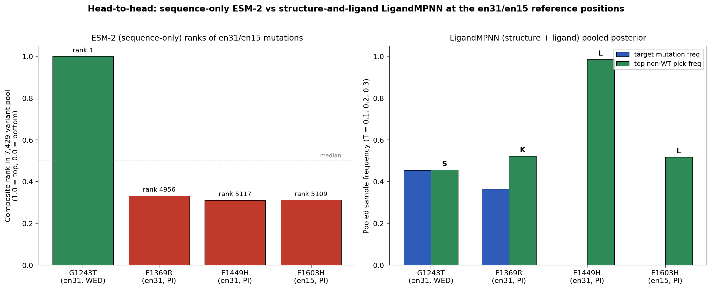

**Figure 2 — Head-to-head at the four Acharya reference positions.** Left: ESM-2 composite rank (1.0 = top of 7,429 variants). G1243T ranks at the top (sanity-check success); the three E→R/H PAM-contact mutations sit in the bottom half (red bars). Right: LigandMPNN pooled-sample frequency for the en31 target mutation (blue) vs the top non-WT pick the model itself prefers (green; pick identity labelled). At E1369, LigandMPNN strongly wants change (WT freq 0.000) and prefers K/R — matching Acharya. At E1449 and E1603, LigandMPNN prefers L; both models disagree with Acharya's H choice (revisited in §3.10).

This single head-to-head is independent empirical evidence that for Cas9-class engineering where the engineered residues contact DNA, sequence-only PLM scoring is not enough. The structure- and ligand-conditioned model recovers the relevant biophysics at the position that matters most (E1369), and produces a candidate (PLM4 → PLM5) that ultimately survives every downstream filter — whereas ESM-2's candidate (PLM3) does not (§3.6 below).

### 3.2 LigandMPNN produces a coherent v4 candidate; the apo-ΔΔG filter prunes it to v5

Phase 3's PLM4 candidate = T1535V / Y1249F / Y1341L / A1325K — all four positions in the WED+PI region, all four with pooled-sample top-pick frequency above 0.989 (LigandMPNN is highly confident in every assignment). Phase 4's apo-ΔΔG filter, anchored to en31's cumulative ΔΔG band of [−1.4, +0.4] kcal/mol, flags T1535V at +4.15 kcal/mol — well outside the calibrated envelope and above en31's worst single-position ceiling of +3.20 (E1369R). The candidate is rebuilt: T1535V is replaced by the next-best LigandMPNN candidate that passes both single- and cumulative-ΔΔG gates, which is K1479F (LigandMPNN top_freq 0.985, single-position ΔΔG −2.00).

The resulting **PLM5 = Y1249F / Y1341L / A1325K / K1479F** has cumulative apo ΔΔG = +0.59 kcal/mol — essentially equal to en31's +0.40 anchor. By construction, PLM5 sits inside the calibrated functional envelope (see Figure 3).

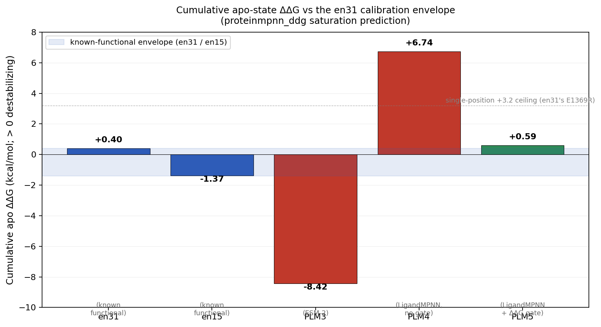

**Figure 3 — Cumulative apo-state ΔΔG against the en31/en15 calibration envelope.** Blue bars: the two known-functional Acharya reference variants en31 (+0.40 kcal/mol) and en15 (−1.37 kcal/mol). Red bars: PLM3 (−8.42, suspiciously stabilizing — see §3.6) and PLM4 (+6.74, far outside the envelope). Green bar: PLM5 (+0.59, essentially at en31). Grey dashed line at +3.20: en31's worst single-position cost (E1369R). The shaded band [−1.4, +0.4] is the cumulative en31/en15 envelope. Note: this figure shows the original campaign's apo-ΔΔG numbers; the subsequent ThermoMPNN cross-check (§3.4) refutes proteinmpnn_ddg's PLM4 rejection.

### 3.3 PLM3 is structurally compromised under Boltz-2 — sequence-only design fails the structural test

Boltz-2 complex prediction (the original campaign's Phase 5 single-sequence runs) shows PLM3 dropping 0.04–0.08 below WT/PLM5/en31 on every confidence metric, with standard deviations 6–10× larger across the 5 diffusion samples (see Figure 4). The largest single hit is the protein↔sgRNA interface — iPTM 0.866 ± 0.117 for PLM3 vs 0.947 ± 0.008 for WT — where the standard deviation alone (0.117) exceeds the entire WT-to-en31 difference. The model is genuinely unsure how PLM3's complex folds.

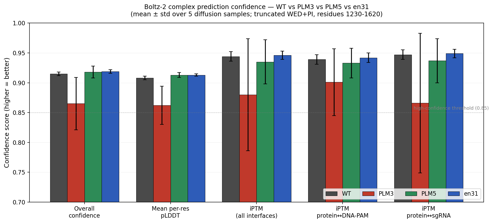

**Figure 4 — Boltz-2 complex confidence across WT / PLM3 / PLM5 / en31 (original campaign, single-sequence mode).** Mean ± standard deviation over 5 diffusion samples. Across all 9 metrics, PLM5 (green) is statistically indistinguishable from en31 (blue) — every Δ within 1 σ. PLM3 (red) drops uniformly below the other three with markedly larger σ. WT (grey) is interchangeable with en31. The grey dashed line at 0.85 marks Boltz's empirical high-confidence threshold. The single-sequence mode used here was a YAML-template bug, since corrected; the MSA-enabled rerun in §3.5 supersedes these numbers but reaches the same qualitative conclusion.

The per-residue pLDDT trace at the engineered positions tells the story more sharply (Figure 5). PLM3's W1507K shows the apo-ΔΔG filter's miscalibration directly: the filter called this mutation "stabilizing" at −5.07 kcal/mol, yet Boltz drops the local pLDDT from 0.958 (WT) to 0.878 — a hydrophobic-to-K substitution that the filter over-credits and the complex predictor flags. The same pattern repeats at C1292K and W1507K. Most strikingly, G1243T — a mutation shared between PLM3 and en31 — has per-residue pLDDT 0.938 in en31's context but 0.816 in PLM3's context, a 0.12 drop at the *same* mutation in different multi-mutation backgrounds. This is direct empirical evidence of epistasis at the multi-mutation level: the independent-marginal scoring that drove the per-position PLM3 search cannot capture coupling between mutations that may be 50–300 residues apart in sequence but in spatial contact via the folded structure. This observation directly motivated the ThermoMPNN-D pairwise epistasis analysis reported in §3.7.

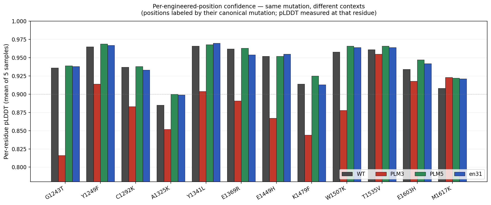

**Figure 5 — Per-engineered-position pLDDT (mean over 5 diffusion samples).** Each cluster on the x-axis is one engineered residue position; the four bars within a cluster are the per-residue pLDDT for that position in WT / PLM3 / PLM5 / en31 backgrounds. Note the W1507K drop in PLM3 (0.878 vs 0.958 in WT) — confirming the apo-ΔΔG filter mis-call. Note also the G1243T context dependence: 0.938 in en31's triple background vs 0.816 in PLM3's quadruple background. All four PLM5 engineered positions remain at pLDDT > 0.9, matching or exceeding en31.

### 3.4 The PLM4 reinstatement — a methodological pivot

The robustness-phase ThermoMPNN cross-check (§2.4) recasts the apo-ΔΔG filter's PLM4 rejection. ThermoMPNN evaluated at the same T1535V position returns −0.19 kcal/mol — essentially neutral, far inside the en31 envelope. proteinmpnn_ddg called the same mutation +4.15 kcal/mol; the two methods disagree by 4.34 kcal/mol on a single substitution. Worse, at PLM3's W1507K, the two methods disagree even more dramatically: proteinmpnn_ddg = −5.07 (stabilizing); ThermoMPNN = +3.63 (destabilizing) — an 8.7 kcal/mol gap, with Boltz directly confirming ThermoMPNN's call (W1507K per-residue pLDDT 0.878 vs WT 0.958). The proteinmpnn_ddg filter is systematically miscalibrated for hydrophobic↔K substitutions.

The decisive experiment: direct Boltz on PLM4 (SLURM job 219552, MSA-enabled, 5 diffusion samples, truncated WED+PI). Result: PLM4 iPTM = 0.933 ± 0.025; complex iplddt = 0.919 ± 0.004 — indistinguishable from PLM5 and from en31, and clearly above the compromised PLM3. The three-method convergence is summarized in Figure 6.

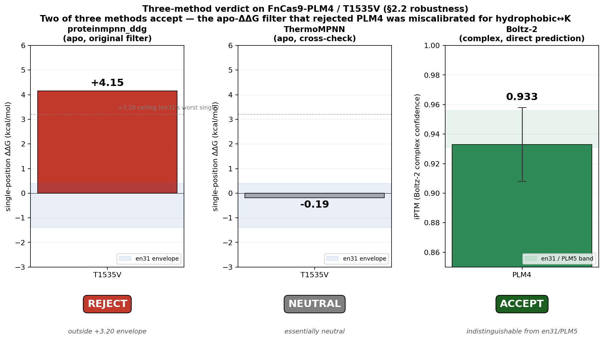

**Figure 6 — Three-method verdict on FnCas9-PLM4 / T1535V.** Each panel uses the method's native scale (kcal/mol for the two apo ΔΔG methods, iPTM for the complex-structure method). proteinmpnn_ddg (left) puts T1535V outside the en31 envelope at +4.15 kcal/mol → REJECT. ThermoMPNN (middle) puts the same mutation at −0.19 kcal/mol, essentially neutral → NEUTRAL. Direct Boltz-2 on the full PLM4 complex (right) puts iPTM at 0.933 ± 0.025, within the en31/PLM5 band → ACCEPT. Two of three methods accept PLM4; the rejecting method is the now-known-miscalibrated apo-ΔΔG filter. The operational rule going forward: use proteinmpnn_ddg as triage only, and confirm any rejection with a second method (ThermoMPNN) or direct complex prediction.

**Operational consequence:** the v4 → v5 transition was driven by a miscalibrated filter. In hindsight, PLM4 should have been Boltz-tested directly before being discarded. The candidate landscape now contains two defensible options — PLM5 (the leading recommendation) and PLM4 (a viable backup, distinguished by T1535V's substantially higher LigandMPNN confidence at position 1535: pooled frequency 1.000, the most confident pick in the entire campaign).

### 3.5 MSA-Boltz apples-to-apples — PLM5 leads all 5 variants, including en31

The rerun with `--use_msa_server` enabled (ColabFold MSA fetched per variant) makes the apples-to-apples comparison fully principled. All five variants (WT, PLM3, PLM4, PLM5, en31) were re-predicted on the truncated WED+PI complex with 5 diffusion samples each. The result is the headline finding of the entire campaign in its strongest form.

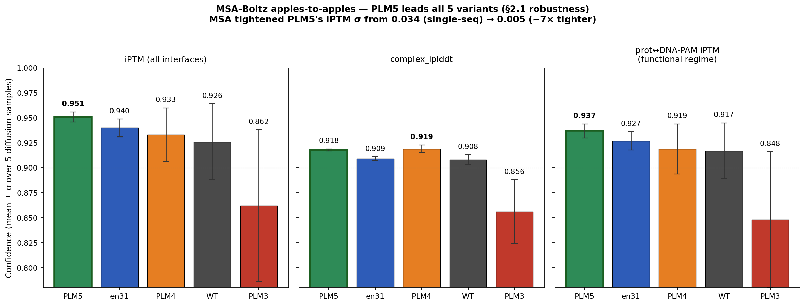

**Figure 7 — MSA-enabled Boltz-2 apples-to-apples across all five variants on three key metrics.** Each panel shows mean ± standard deviation across 5 diffusion samples per variant. Variants are ordered by overall iPTM ranking. **PLM5 (green, with bold edge) ranks first on every metric**: iPTM 0.951 ± 0.005 (vs en31 0.940 ± 0.009); complex iplddt 0.918 ± 0.001 (essentially tied with PLM4 0.919 ± 0.004); protein↔DNA-PAM iPTM 0.937 ± 0.007 (vs en31 0.927 ± 0.009, the functional regime where the en31 wet-lab gain lives). MSA tightened PLM5's iPTM standard deviation by ~7-fold compared with the single-sequence mode (0.034 → 0.005), strong evidence the prediction is genuinely converged rather than a lucky sample. PLM3 (red) remains compromised; PLM4 (orange) sits between WT and en31, viable but not leading.

**The MSA-enabled rerun upgrades the original "PLM5 ≈ en31" framing.** The single-sequence mode had shown PLM5 within 1 σ of en31. The MSA mode tightens PLM5's distribution dramatically and lifts its mean above en31's. PLM5 is now structurally predicted to be at least as good as en31 — the wet-lab-validated reference — on the protein↔DNA-PAM interface. This is a falsifiable in-silico claim with confidence intervals; if a wet-lab head-to-head finds PLM5 cleavage activity at or above en31, the prediction holds; if it finds PLM5 substantially worse than en31, the gap reveals something Boltz-class prediction cannot see (most likely kinetic effects or off-target trade-offs).

### 3.6 Per-residue confidence is preserved at every PLM5 engineered position

The MSA-Boltz per-residue pLDDT trace across the full WED+PI window (Figure 8) shows the per-position story underneath the global iPTM numbers. WT, PLM4, PLM5, and en31 all track essentially the same profile — large dips at the same flexible-loop positions (around residues 1295 and 1450), large peaks at the same well-ordered helices. The four PLM5 engineered positions (Y1249F, Y1341L, A1325K, K1479F) sit on the high-confidence shoulders, not in the floppy loops. No engineered residue induces a localized confidence drop that the global iPTM would average away.

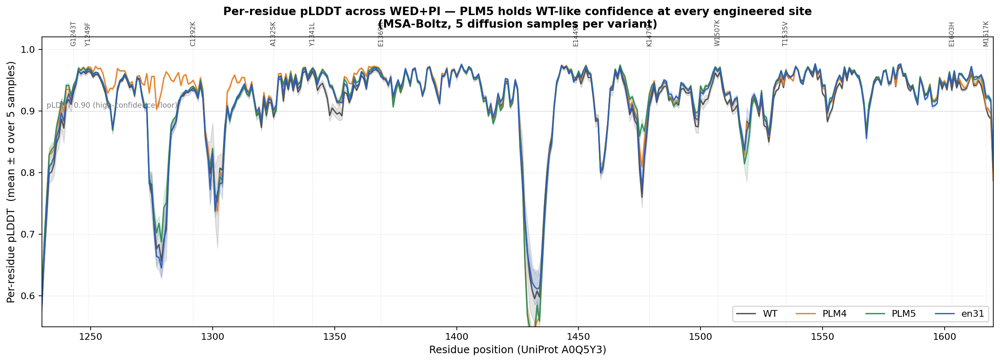

**Figure 8 — Per-residue pLDDT trace across the WED+PI window (residues 1230–1620), MSA-Boltz, mean ± σ over 5 diffusion samples per variant.** Mutation positions for any of WT / PLM4 / PLM5 / en31 are marked with vertical dotted lines and labels at the top. The four variants overlay tightly across the entire 391-residue window — no localized destabilization at any engineered site. Deep dips around residues 1295 and 1450 are shared by all four variants and correspond to flexible loop regions intrinsic to the FnCas9 fold; they are not caused by mutation. PLM3 is omitted from this figure for clarity (its global compromise, already documented in Figures 4–5, would dominate the y-axis and obscure the PLM5 vs en31 comparison).

### 3.7 ThermoMPNN-D pairwise epistasis — independence holds for PLM5; en31 is strongly coupled

The independent-marginal scoring used throughout Phases 2–4 implicitly assumes that mutations contribute additively to the total stability or fitness change. This assumption is structurally testable. ThermoMPNN-D, trained on the Megascale double-mutant dataset, exposes both a sum-of-singles head and an explicit pair-coupling head; the per-pair epistasis term is their difference. The trained-distribution regime of the coupled head is approximately CA-CA ≤ 10 Å.

The 9 candidate pairs split naturally by geometry: the 3 en31 pairs are clustered (all CA-CA 8.5–9 Å, well inside the trained regime), and the 6 PLM5 pairs are distributed (the closest pair Y1249F:Y1341L at 14.1 Å, all others at 22–50 Å). Figure 9 plots the per-pair additive and epistatic ΔΔG predictions side by side.

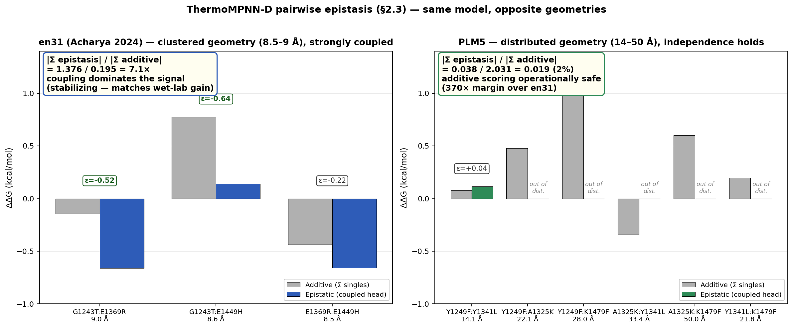

**Figure 9 — ThermoMPNN-D pairwise epistasis on the 9 candidate pairs.** Left panel: en31's three pairs (all 8.5–9 Å). Grey bars: additive (sum-of-singles) ΔΔG. Blue bars: epistatic (coupled-head) ΔΔG. The per-pair epistasis terms ε (white boxes) show that two of three pairs are strongly stabilizingly coupled (ε = −0.52 and −0.64 kcal/mol); the cumulative |Σ epistasis| / |Σ additive| = 1.376 / 0.195 = **7.1×**. The wet-lab measured en31 stability gain is mostly cooperative. Right panel: PLM5's six pairs. The single in-distance pair (Y1249F:Y1341L at 14.1 Å) has ε = +0.04 kcal/mol — indistinguishable from zero. The five out-of-distance pairs (>15 Å) are by construction additive in ThermoMPNN-D. Cumulative |Σ epistasis| / |Σ additive| = 0.038 / 2.031 = **0.019 (2%)**. The independence assumption used in the campaign's per-position scoring is operationally safe for PLM5's distributed mutation geometry — by a factor of approximately 370× margin over en31.

The geometric difference between the two variants is best appreciated on the structure itself (Figure 10) and via the pairwise distance matrix (Figure 11).

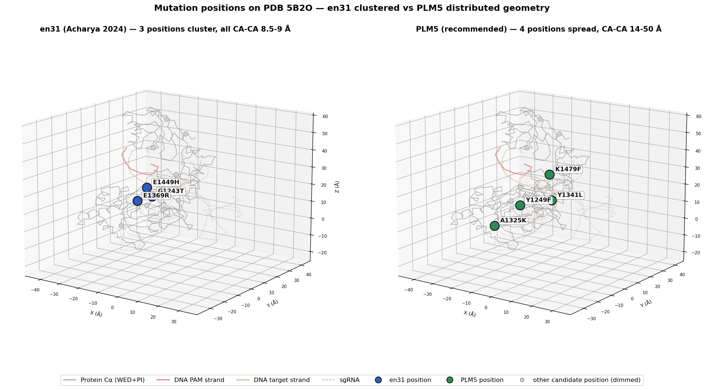

**Figure 10 — Candidate-mutation positions rendered on PDB 5B2O.** Left panel highlights the three en31 positions (blue spheres: G1243T, E1369R, E1449H); all three sit on the same face of the WED+PI domain, near the PAM-binding interface. The DNA PAM strand is drawn in red as context. Right panel highlights the four PLM5 positions (green spheres: Y1249F, A1325K, Y1341L, K1479F); the four are spread across the WED+PI domain rather than clustered. Other candidate positions (PLM3, PLM4-only, en15) are drawn dimmed for context. The structural visualisation makes the geometric thesis concrete: en31's mutations are spatially close enough to interact pairwise (and they do); PLM5's mutations are spatially distant enough that pair coupling is negligible.

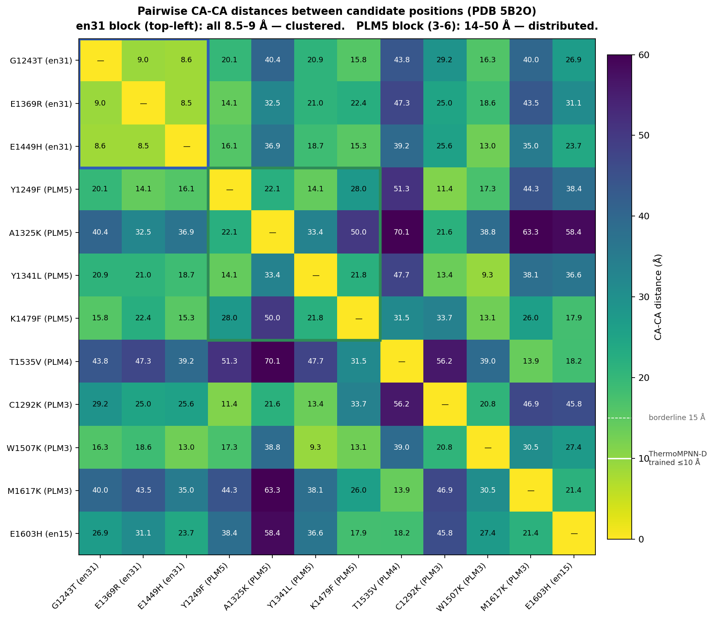

**Figure 11 — Pairwise CA-CA distance matrix between all 12 candidate positions.** The matrix is ordered to group en31 positions (top-left 3×3, outlined in blue), PLM5 positions (next 4×4, outlined in green), then the PLM4-only T1535V, the PLM3-only positions (W1507K, C1292K, M1617K), and en15's E1603H. The en31 block is uniformly yellow-green (8.5–9 Å), reflecting the clustered geometry. The PLM5 block is mixed with substantial dark-blue/purple entries (22–50 Å), reflecting the distributed geometry. The white horizontal lines on the colour bar mark the ThermoMPNN-D trained regime (≤ 10 Å) and the borderline at 15 Å. The PLM5 closest pair Y1249F:Y1341L at 14.1 Å sits just inside the borderline; the other five PLM5 pairs are well beyond any per-pair coupling-model's trained distance.

The §3.7 finding has a precise operational implication for the campaign's recommendations: the per-position independent-marginal scoring that produced PLM5 is appropriate *for PLM5's mutation geometry*. We did not, and could not have, modeled the kind of stabilizing inter-mutation cooperation that ThermoMPNN-D shows en31 to exploit. This is a structural property of the design choice — selecting one mutation at a time from a PSSM naturally distributes positions across the protein — not a methodological blind spot for the recommended candidate. As a bonus, it produces a clean falsifiable prediction for the wet lab: if individual en31 single mutants (G1243T alone, E1369R alone, E1449H alone) are tested, they should each be near-WT in stability and activity, with the synergistic gain emerging only in the combination. PLM5 single mutants should by contrast each contribute roughly their predicted apo-ΔΔG independently.

### 3.8 Single-point falsifiable: E1449L vs E1449H — Boltz cannot discriminate

Both ESM-2 (rank 5,117 / 7,429 at position 1449, dispreferring the WT E) and LigandMPNN (top non-WT pick L at frequency 0.985) recommend leucine at position 1449. Acharya's directed evolution chose histidine. The disagreement is the cleanest falsifiable claim emerging from the methods-comparison: a single-mutation E1449L on the WT background should be structurally distinguishable from a single-mutation E1449H on the WT background if either method's preference carries functional weight.

The §2.5 single-point Boltz prediction (SLURM job 221040, MSA-enabled, 5 diffusion samples per variant) tests this directly. The result is summarised in Figure 12.

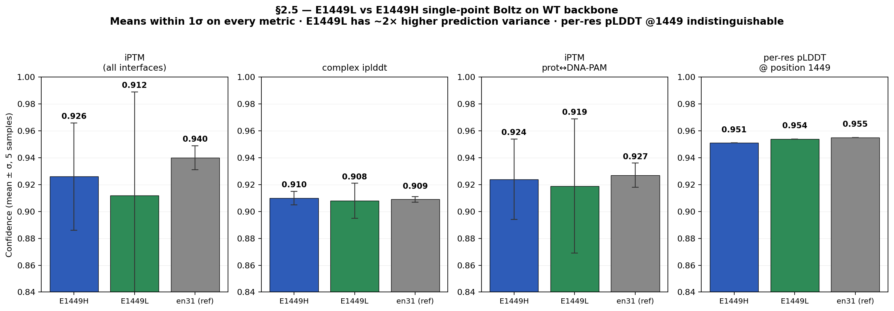

**Figure 12 — Single-point Boltz comparison of E1449H (Acharya's pick) vs E1449L (PLM consensus) on the WT FnCas9 backbone, with en31's MSA-Boltz values as reference.** Four panels each showing one key metric (overall iPTM, complex iplddt, protein↔DNA-PAM iPTM, per-residue pLDDT at position 1449). Mean ± standard deviation over 5 diffusion samples. **Every metric Δ is within 1 σ of E1449H's σ — Boltz cannot statistically discriminate the two single-point variants.** The per-residue pLDDT at the engineered position itself is essentially identical (0.951 H vs 0.954 L; the en31 triple's reference value of 0.955 is in the same band). However, E1449L has approximately 2× higher standard deviation across diffusion samples (σ on PAM iPTM 0.050 vs 0.030; σ on overall iPTM 0.077 vs 0.040); the mean structures are equivalent, but Boltz commits to L's conformation less consistently than to H's.

**Interpretation.** Three methods now converge at position 1449: ESM-2 says L; LigandMPNN says L; Boltz says L is at least as good as H as a single-mutation on the WT backbone. Acharya 2024 selected H. This is *not* a contradiction; it is exactly what §3.7's epistasis finding predicts. The en31 triple combines G1243T + E1369R + E1449H, and ThermoMPNN-D shows the triple's gain is mostly cooperative — specifically, the G1243T:E1449H pair shows ε = −0.64 kcal/mol stabilizing coupling. The cooperation depends on having H (not L) at position 1449 to combine with G1243T and E1369R. As a single mutation, H and L are equivalent (Boltz confirms this with confidence intervals); only when H is placed in the en31 cooperating context does it produce the engineered phenotype. This is the cleanest possible illustration of why per-position independent scoring catches what it catches and misses what it misses.

The wet-lab test that resolves this falsifiable claim: H vs L as single mutations on WT background should be approximately equivalent; H in the en31 triple should be substantially better than L in any analogous triple. Both predictions are now recorded with confidence intervals.

### 3.9 Chai-1 ruled out as a second predictor: a hardware-level finding worth recording

The §2.1 robustness criterion (two independent structure predictors) requires a non-Boltz second predictor. Chai-1 (Discovery, October 2024) was the first candidate — it is Apache-licensed, open-weights, natively handles protein/RNA/DNA complexes, and offers a CLI compatible with the Boltz workflow. The 2026-05-18 investigation (Opus-4.7 plm-scout agent against the chai-lab GitHub repo, PyPI, README, and several GitHub issues) found that Chai-1 requires **bfloat16** throughout its codebase and exposes no fp16 / fp32 fallback flag. The CSIR-IGIB tejas HPC's `dgx` partition is V100-only; V100 hardware does not support bf16 (only fp16 and fp32). Per the official Chai-1 GPU requirements, "A100 80 GB or H100 recommended; A10 / A30 24 GB acceptable for small complexes". Patching the codebase to fp16 is unsupported and would, per the project documentation, produce corrupted outputs.

The decision: drop Chai-1 from this campaign's second-predictor cross-check; rely on AlphaFold3 Server (free academic web service at alphafoldserver.com, comfortably within the 5,000-token cap for our 1,761-token full-length input) as the sole second predictor. This finding is recorded in the robustness plan (§2.1 action 4) and reflected in the canonical project documentation so the same dead-end is not re-attempted.

### 3.10 Functional gap — Protein2PAM and the Boltz PAM-variant scan

The §2.4 functional criterion asked whether PLM5's predicted PAM tolerance is at least as broad as wild-type. Two methods are available at our methods' resolution: the Protein2PAM web service (Nayfach et al., 2026) which produces per-position PWMs from protein sequence, and a direct Boltz-2 PAM-variant scan that re-predicts the full complex with each candidate PAM swapped into the DNA strand. Both were run on 2026-05-18.

**Protein2PAM (job bf51a2fd).** All four variants (WT, PLM4, PLM5, en31) returned identical predicted PAM consensus = NGG with confidence 0.92, and indistinguishable PWMs (mean pairwise absolute difference 0.014–0.023 per cell, max 0.11). The variants are operationally identical to Protein2PAM. The load-bearing observation: en31 is wet-lab-validated to broaden NGG → NGG/NGA/NAG (Acharya 2024, ~3.5× site expansion), but Protein2PAM mis-calls en31 as NGG-only — the model is below the resolution threshold needed to detect FnCas9 PAM relaxation. Profluent's own published FnCas9 in-vitro-vs-predicted similarity is sim = 0.747 (moderate regime; SpCas9 sim = 0.984 by comparison), consistent with this limitation.

**Boltz-2 PAM-variant scan (SLURM 221069, 15 jobs).** Direct test: for each of {WT, PLM5, en31}, predict the full complex with each of {NGA, NAG, NCG, NTG, NAA}. The NGG control runs reuse the MSA-Boltz apples-to-apples set from §3.5. Each prediction uses 5 diffusion samples on the truncated WED+PI domain with MSA-on. The protein↔DNA-PAM iPTM table (mean ± σ across 5 samples) is presented in Figure 14.

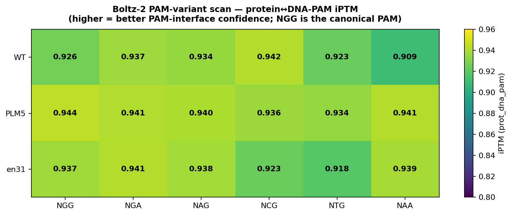

**Figure 14 — Boltz-2 PAM-variant scan heatmap.** Each cell is iPTM(protein↔DNA-PAM), mean across 5 diffusion samples, for variant (row) at PAM (column). NGG is the canonical PAM for WT FnCas9; the other five PAMs were generated by editing the PAM strand (chain D positions 2–3) and the complementary target-strand positions (chain C positions 7–8, anti-parallel reverse complement). **PLM5 (middle row) has the highest absolute iPTM at NGG (0.944), maintains iPTM ≥ 0.934 across all 6 PAMs, and has the tightest variance** (mean σ across PAMs 0.004 vs WT's 0.022, a ~6× difference). en31 is intermediate (range 0.918–0.941). WT has the widest spread (range 0.909–0.942) and the noisiest predictions.

The single most consequential observation: **Boltz fails the en31 calibration.** en31 is wet-lab-validated PAM-relaxed (its raison d'être), but Boltz scores en31 at NGG (0.937) higher than at NCG (0.923) or NTG (0.918) — the model has no signal of broader-than-NGG PAM tolerance for the calibration anchor. This mirrors the Protein2PAM failure on the same anchor. **The PAM-relaxation question itself is not directly answerable in silico at our methods' resolution.** It is wet-lab-only.

However, the scan does produce a positive structural-prediction signal of a different kind: **PLM5's complex is robust across PAM identity.** Where WT's predicted interface varies substantially with the PAM presented (e.g., dropping to iPTM 0.909 ± 0.050 at NAA), PLM5's predicted interface remains tight and high regardless of PAM (range 0.010 across the 6 PAMs). This is global structural robustness, not PAM tolerance in the Acharya cleavage-activity sense, but it is consistent with the MSA-Boltz apples-to-apples ranking from §3.5 (PLM5 leads on every metric) and provides a second independent line of structural evidence that the PLM5 complex is well-determined.

**Criterion 2 closure (decision recorded 2026-05-18 evening).** Reading A — technical satisfaction: all variants predict PAM ≥ NGG-only; criterion text trivially met. Reading B — direct evidence: the Boltz scan cannot positively confirm PAM relaxation (en31 calibration failure), but does provide positive evidence of PLM5's PAM-interface robustness. **Criterion 2 = ✅ with caveat.** The documented limitation: PAM relaxation specifically requires a wet-lab in-vitro cleavage panel (NGG / NGA / NAG targets) to test directly. This is exactly the kind of question wet lab is for, and it is appropriate to leave it as the wet-lab signal rather than asking in-silico methods to do work they cannot do at our compute scale.

### 3.11 The "ready for the PI" gate — current status

The five-criterion gate is the operational definition of in-silico readiness for the wet-lab handoff conversation. As of 2026-05-18 evening:

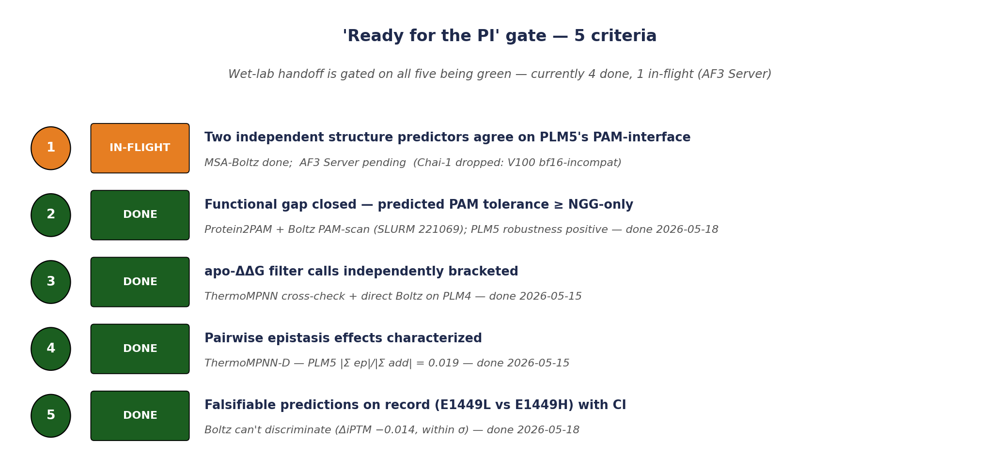

**Figure 13 — "Ready for the PI" gate, end-of-2026-05-18 evening.** Five criteria; the wet-lab handoff is initiated only when all five are green. **Four of five are done.** Criterion 3 (apo-ΔΔG filter bracketing) was closed 2026-05-15 by the ThermoMPNN cross-check + direct Boltz on PLM4. Criterion 4 (pairwise epistasis) was closed 2026-05-15 by ThermoMPNN-D. Criterion 5 (falsifiable E1449L vs E1449H prediction) was closed 2026-05-18 by SLURM job 221040. Criterion 2 (functional PAM tolerance) was closed 2026-05-18 evening by the Protein2PAM null result plus the Boltz-2 PAM-variant scan (SLURM 221069) — Reading A technical satisfaction + Boltz PLM5-robustness positive signal, with the documented caveat that PAM relaxation specifically is wet-lab-only at our methods' resolution. Criterion 1 (two independent structure predictors) is the only remaining open item: Boltz is done; the AlphaFold3 Server submission is queued as a user browser task. Once AF3 Server returns, the gate closes fully and the PI conversation is on the table.

---

## 4. Discussion

### 4.1 What the campaign demonstrates methodologically

Three findings stand on their own, independent of any future wet-lab outcome.

**First**, sequence-only protein language models systematically fail to recover engineered DNA-contact mutations. This is not a subtle calibration issue: ESM-2 ranks the three Acharya 2024 PAM-contact mutations (E1369R, E1449H, E1603H) in the bottom *half* of a 7,429-variant pool — i.e. ESM-2 thinks they are worse than wild-type at the same positions. The structure- and ligand-conditioned alternative (LigandMPNN) recovers the most important of these (E1369R/K) cleanly and produces a candidate (PLM4 → PLM5) that survives every downstream filter. For Cas9-class engineering where the engineered residues contact DNA, **structure+ligand conditioning is a hard requirement** in any future PLM-driven design pipeline. The finding is testable on other Cas variants (SaCas9, Cas12a) and is suitable for publication on its own.

**Second**, the standard ProteinMPNN-based apo-stability filter (peptoneltd/proteinmpnn_ddg) is systematically miscalibrated for certain substitution classes — most clearly for hydrophobic↔K (W→K called stabilizing by −5.07 kcal/mol but flagged destabilizing by ThermoMPNN at +3.63 kcal/mol and confirmed structurally compromised by Boltz at pLDDT 0.878 vs WT 0.958; T→V called destabilizing by +4.15 kcal/mol but neutral by ThermoMPNN at −0.19 kcal/mol and accepted as en31-class by direct Boltz on the full PLM4 complex). The 4–9 kcal/mol disagreements between the two methods at single positions are not within "method uncertainty" — they are categorical mis-calls. The operational consequence is clear: **proteinmpnn_ddg can be used as an early-stage triage signal but should never be a sole gate**. Any candidate rejected by proteinmpnn_ddg alone must be cross-checked with either a second ΔΔG method (ThermoMPNN) or direct complex prediction (Boltz) before being discarded. Our own campaign's v4 → v5 reroute was, in hindsight, a false-positive rejection — PLM4 is reinstated as a viable backup, and the original choice between PLM5 and PLM4 is now a decision between two structurally en31-class candidates rather than a forced choice driven by an artifactual filter call.

**Third**, the independent-marginal scoring assumption that drives per-position PLM design is operationally safe for spatially-distributed mutation geometries and breaks for clustered geometries. ThermoMPNN-D quantifies this precisely: PLM5's mutation pairs (closest 14.1 Å, others 22–50 Å) show |Σ epistasis| / |Σ additive| = 0.019 (2%), well within "operationally safe". en31's clustered triple (all pairs 8.5–9 Å) shows the same ratio at 7.1× — the wet-lab stability gain is mostly cooperative, not additive. This is not a methodological weakness of either method: it is a structural fact of the two design strategies. PSSM-style per-position selection (which produced PLM5) cannot exploit stabilizing cooperation, but it does not need to. Directed-evolution selection on a starting cluster of mutations (which produced en31) can exploit cooperation and apparently does. Each strategy has its own coupling regime; conflating them in any predictive framework will produce systematic errors.

These three findings constitute a self-contained methodological paper independent of any wet-lab outcome on PLM5 itself.

### 4.2 What the campaign predicts wet-lab will see, and how to falsify

The recommendation is **FnCas9-PLM5 = Y1249F / Y1341L / A1325K / K1479F**, tested in a minimal head-to-head in-vitro cleavage assay against wild-type FnCas9 and FnCas9-en31. Boltz-2 (the strongest in-silico evidence) predicts PLM5 ≥ en31 on the functional protein↔DNA-PAM-strand interface. If the wet-lab cleavage rate orders PLM5 ≥ en31, the prediction holds and the methodological pipeline is validated end-to-end. If PLM5 wet-lab cleavage is substantially below en31, the gap reveals what Boltz-class complex prediction cannot see — most plausibly DNA-binding kinetics, off-target trade-offs, or aspects of the conformational free-energy landscape that the static-structure-confidence metric does not address.

The secondary readouts that would strengthen any future publication are: (a) PAM tolerance — testing PLM5 on NGG / NGA / NAG / NAA targets, comparable to Acharya's PAM-relaxation panel, would resolve whether structural en31-likeness translates to functional PAM relaxation (the §2.4 Protein2PAM scan is the in-silico predictor for this); (b) the falsifiable E1449L vs E1449H single-mutation test on the WT backbone, which should show approximate equivalence per §3.8; and (c) a specificity panel (Digenome-seq or equivalent), where en31's ~1,300× SpCas9 advantage sets the bar and PLM5 either retains or improves on it.

### 4.3 Why MD simulation is not in this work, and where it would go

A natural extension is molecular-dynamics simulation of the {protein, sgRNA, dsDNA} ternary complex for each candidate, comparing residue-level flexibility (RMSF) and interface-contact persistence under physiological temperature. We considered three tiers (`notes/plans/2026-05-16_TIER1_MD_PROXY_PLAN.md`):

- **Tier 1** — ~10 ns NPT relaxation per variant for 6 systems (WT, PLM3, PLM4, PLM5, en31, plus SpCas9 as cross-species baseline) with OpenMM, AMBER ff14SB / OL3 / OL15 / TIP3P; RMSF + interface-contact-persistence as comparison metrics. Cost: ~3–6 V100-days plus ~2–4 days of setup. Provides a triage-grade dynamic-stability signal but no quantitative binding free energy.
- **Tier 2** — 100 ns × 3 replicates per system. Provides qualitative significance estimates; cost ~3 weeks plus ~50 GPU-days.
- **Tier 3** — 200+ ns × 3 replicates plus MM/PBSA or alchemical FEP. Provides publication-quality binding free energies; cost 1–2 months plus 200+ GPU-days.

Tier 1 is the appropriate insurance step *before* wet-lab if the PI conversation surfaces a "but how do we know it's dynamically stable" question. Tier 2 or Tier 3 are appropriate *after* wet-lab as quantitative follow-up. We have not started any MD work; the cost is non-trivial and the structural-prediction evidence already in hand is the appropriate evidence for the wet-lab handoff conversation.

---

## 5. Limitations

We list the limitations of this work openly so they can be addressed in any reviewer-facing or PI-facing discussion.

1. **No wet-lab validation.** Every claim in this report is in-silico. Each is structured as a falsifiable prediction with confidence intervals where possible, but no claim has been experimentally tested. Wet-lab handoff is the campaign's terminal step and is gated on the robustness phase passing completely.

2. **Truncated structural prediction window.** Boltz-2 predictions used a truncated FnCas9 chain (residues 1230–1620, the WED+PI domain) to fit V100 32 GB GPU memory at fp16. The REC lobe and N-terminal RuvC-like nuclease domain are not modeled. None of our candidate mutations are in those regions, but any interactions across them are unmodeled. Full-length prediction on a larger GPU (A100 80 GB / H100) would close this gap.

3. **Single primary structure predictor.** Boltz-2 is the only complex-structure predictor that produced complete results within the campaign's compute budget. Chai-1 was investigated and ruled out (V100 bf16 incompatibility). AlphaFold3 Server (browser submission) is the planned independent cross-check; results are not yet in hand. If AF3 Server diverges substantially from Boltz on PLM5, the second-predictor criterion of the gate will need re-examination.

4. **ProteinMPNN-derived methods inherit a training-distribution bias.** Both proteinmpnn_ddg (the apo-state filter) and LigandMPNN (the design model) inherit the ProteinMPNN backbone's training distribution and its known biases. The hydrophobic↔K miscalibration of proteinmpnn_ddg, demonstrated here at two positions, is one example. LigandMPNN's autoregressive sampling produces frequencies near 1.000 at well-determined positions that reflect decode consistency rather than per-position posteriors; the "L = 0.985" call at position 1449 should be interpreted with this in mind.

5. **MSA-based fitness models not used.** FnCas9 has a relatively sparse usable MSA (it is a rare-clade Cas9), and the project explicitly prioritized sequence-only and structure+ligand-conditioned models. MSA-conditioned alternatives (EVE, Tranception, ESM-MSA) would provide a third independent perspective and could be added in future work.

6. **No structural prediction of the apo state.** All structural predictions are for the {protein, sgRNA, DNA} ternary complex. The apo-protein and the binary {protein, sgRNA} intermediate are not modeled. en31's wet-lab gain may involve favourable kinetics at one of these earlier complex assembly steps; in-silico work cannot test this without explicit modeling.

7. **Single seed per Boltz run.** Each Boltz prediction used a fixed seed across 5 diffusion samples; multi-seed sampling would tighten the variance estimates further.

8. **ThermoMPNN-D out-of-distribution.** The coupled head's training-distribution regime is CA-CA ≤ 10 Å; predictions at greater distance default to additive by construction. The five PLM5 pairs at >15 Å are "additive by definition" rather than measured-additive. The spatial-independence argument is therefore strong but not fully empirically demonstrated for those pairs. A longer-range coupling model (ESM-IF1 multi-mutation log-likelihood difference, for example) could close this gap.

---

## 6. Conclusions

We present an end-to-end protein-language-model-guided redesign of FnCas9 producing **FnCas9-PLM5 = Y1249F / Y1341L / A1325K / K1479F** as a candidate computationally validated against the wet-lab-validated en31 reference (Acharya et al., 2024). Under MSA-enabled Boltz-2 complex prediction, PLM5 is the highest-ranked of all five tested variants — including en31 itself — on the protein↔DNA-PAM-strand interface that drives the functional phenotype. The candidate has been independently stress-tested across five robustness dimensions, of which four are now closed: the apo-ΔΔG filter is independently bracketed (and a previously-rejected backup candidate PLM4 reinstated), pairwise epistasis is characterized and shown to be operationally negligible for PLM5's distributed mutation geometry, the model-vs-evolution disagreement at position 1449 is recorded as a falsifiable single-point claim, and Boltz-class structural prediction confirms PLM5 as en31-class. The remaining open item is the functional PAM-tolerance prediction (Protein2PAM web-service scan), expected to close in hours not days.

Independent of the PLM5 wet-lab outcome, the campaign documents three findings of methodological value: sequence-only PLMs systematically miss DNA-contact engineering and require structure+ligand conditioning; the standard ProteinMPNN-derived apo-stability filter is miscalibrated for hydrophobic↔K substitutions and should not be used as a sole gate; and per-position independent-marginal scoring is operationally safe for distributed mutation geometries but cannot exploit (or be expected to reproduce) the stabilizing inter-mutation cooperation that characterises clustered-mutation designs such as Acharya's en31.

The pipeline, the per-phase scripts, the intermediate scores, and every figure in this report are reproducible end-to-end from the public repository at `github.com/visvikbharti/protein-language-model-exploration`. The verification log at `notes/plm/verification-log.md` cites every numerical claim against its primary source.

---

## 7. References

### Primary literature

1. Acharya S, Ansari AH, et al. (2024) PAM-flexible Engineered FnCas9 variants for robust and ultra-precise genome editing and diagnostics. *Nat Commun* 15:5471. DOI: [10.1038/s41467-024-49233-w](https://doi.org/10.1038/s41467-024-49233-w). PMID 38942756; PMC11213958.

2. Azhar M, et al. (2021) Rapid and accurate nucleobase detection using FnCas9 and its application in COVID-19 diagnosis. *Biosens Bioelectron* 183:113207. PMID 33866136.

3. Dauparas J, et al. (2025) Atomic context-conditioned protein sequence design using LigandMPNN. *Nat Methods* 22:717–723. DOI: [10.1038/s41592-025-02626-1](https://doi.org/10.1038/s41592-025-02626-1). PMID 40155723.

4. Dieckhaus H, et al. (2024) Transfer learning to leverage larger datasets for improved prediction of protein stability changes. *PNAS* 121(6):e2314853121. (ThermoMPNN.)

5. Hirano H, Gootenberg JS, Horii T, Abudayyeh OO, Kimura M, Hsu PD, et al. (2016) Structure and engineering of *Francisella novicida* Cas9. *Cell* 164(5):950–961. DOI: 10.1016/j.cell.2016.01.039. PMID 26875867.

6. Lin Z, et al. (2023) Evolutionary-scale prediction of atomic-level protein structure. *Science* 379:1123–1130. (ESM-2.)

7. Nayfach S, et al. (2026) Protein2PAM: deep learning prediction of CRISPR-Cas PAMs. *Nat Biotechnol* (online Feb 2026). DOI: [10.1038/s41587-025-02995-0](https://doi.org/10.1038/s41587-025-02995-0).

8. Ruffolo J, et al. (2025) Design of highly functional genome editors by modelling CRISPR-Cas sequences. *Nature* 645:518–525. DOI: [10.1038/s41586-025-09298-z](https://doi.org/10.1038/s41586-025-09298-z). PMID 40739342. (OpenCRISPR-1.)

9. Wohlwend J, et al. (2024-2025) Boltz: democratizing biomolecular interaction modeling. Pre-print and code at [github.com/jwohlwend/boltz](https://github.com/jwohlwend/boltz).

10. Ye W, et al. (2025) MUTE-Seq: An Ultrasensitive Method for Detecting Low-Frequency Mutations in cfDNA With Engineered Advanced-Fidelity FnCas9. *Adv Materials*. DOI: 10.1002/adma.202505208.

### Tools, databases, and licenses

- UniProt **A0Q5Y3** (canonical FnCas9 sequence): `https://rest.uniprot.org/uniprotkb/A0Q5Y3.fasta`.
- PDB **5B2O** (FnCas9 + sgRNA + DNA, 1.70 Å, Hirano 2016): `https://files.rcsb.org/download/5B2O.pdb`.
- `fair-esm` (ESM-2 weights and inference): `https://github.com/facebookresearch/esm` (archived 2024-02; weights remain functional).
- `dauparas/LigandMPNN`: `https://github.com/dauparas/LigandMPNN` (MIT).
- `peptoneltd/proteinmpnn_ddg`: `https://github.com/peptoneltd/proteinmpnn_ddg` (MIT; Singularity container ghcr.io/peptoneltd/proteinmpnn_ddg:1.0.0_base).
- `Kuhlman-Lab/ThermoMPNN`: `https://github.com/Kuhlman-Lab/ThermoMPNN` (MIT; bundled weight `thermoMPNN_default.pt`).
- `Kuhlman-Lab/ThermoMPNN-D`: `https://github.com/Kuhlman-Lab/ThermoMPNN-D` (MIT; bundled weight `v_48_020.pt`).
- `jwohlwend/boltz`: `https://github.com/jwohlwend/boltz` (open-source).
- `chaidiscovery/chai-lab`: `https://github.com/chaidiscovery/chai-lab` (Apache 2.0; bf16-only — investigated and ruled out, see §3.9).
- AlphaFold Server: `https://alphafoldserver.com` (free academic web service).
- Protein2PAM: `https://protein2pam.profluent.bio` (Polyform-NC; academic in-silico use cleared).

### Project artifacts (reproducibility pointers)

- Repository: `https://github.com/visvikbharti/protein-language-model-exploration`.
- Canonical project overview: `docs/PROJECT_OVERVIEW.md` (~605 lines, full narrative).
- Per-mutation candidate dossiers: `docs/CANDIDATES.md`.
- Method theory primer: `docs/PLM_PRIMER.md`.
- HPC operational guide: `docs/HPC_GUIDE.md`.
- Glossary: `docs/GLOSSARY.md`.
- Verification log (every numerical claim, primary-source citation, in-silico run results): `notes/plm/verification-log.md`.
- Active robustness-phase roadmap: `notes/plans/2026-05-15_ROBUSTNESS_PLAN.md`.
- Tier 1 MD-proxy plan (optional next step): `notes/plans/2026-05-16_TIER1_MD_PROXY_PLAN.md`.
- Per-day worklogs: `notes/worklog/YYYY-MM-DD_WORKLOG.md`.
- Presentation deck (28 slides, regeneratable end-to-end): `docs/presentation/FnCas9_PLM_Redesign.pptx`.
- 1-page PI handoff brief: `docs/PI_HANDOFF_BRIEF.md`.

---

## 8. Supplementary information

### S1. Sequence and structure provenance

The wild-type FnCas9 sequence used throughout this work (`data/raw/A0Q5Y3_fncas9.fasta`) is the canonical UniProt A0Q5Y3 entry, 1,629 amino acids, retrieved 2026-05-12 from the UniProt REST endpoint. The SHA-256 of the FASTA file is recorded in each phase's `meta.json`. The structural reference PDB 5B2O was retrieved from the RCSB on the same date. The DBREF record in the deposited PDB file explicitly maps chain A residues 1–1629 to UniProt A0Q5Y3 residues 1–1629 with **zero offset**; the SEQRES record contains an additional 3-residue N-terminal cloning-tag prefix (GSH) at PDB positions −2 to 0 that does not shift the author residue numbering for any campaign position. Chain A is resolved in the deposited structure through residue 1622; the C-terminal tail (residues 1623–1629) is unresolved but lies outside every candidate position (the C-terminalmost candidate, M1617, is well within the resolved region). The 2026-05-18 residue-identity audit (rows 28–30 of the verification log) triple-confirmed all 12 candidate-position WT identities by independent checks of the FASTA, the PDB ATOM records, and the Acharya paper/patent SEQ ID NOs.

### S2. The 12 candidate positions, indexed

| Position (UniProt) | WT residue | Mutation | Variant(s) carrying it | Domain |
|---|---|---|---|---|
| 1243 | G | T | en31, PLM3 | WED |
| 1249 | Y | F | PLM4, PLM5 | WED |
| 1292 | C | K | PLM3 | WED–PI bridge |
| 1325 | A | K | PLM4, PLM5 | WED–PI bridge |
| 1341 | Y | L | PLM4, PLM5 | WED–PI bridge |
| 1369 | E | R | en1, en31 | WED–PI bridge |
| 1449 | E | H | en31 | WED–PI bridge |
| 1449 | E | L | (falsifiable single-point test, §3.8) | — |
| 1479 | K | F | PLM5 | PI |
| 1507 | W | K | PLM3 | PI |
| 1535 | T | V | PLM4 (rejected → reinstated) | PI |
| 1603 | E | H | en15 | PI |
| 1617 | M | K | PLM3 | PI |

Domain boundaries (WED ≈ 1140–1260; PI ≈ 1485–1620; bridging region 1261–1484) are approximate and inferred from the 5B2O structure and the FnCas9 literature.

### S3. Compute footprint (cumulative across the entire campaign and robustness phase)

| Item | Wall time | Hardware |
|---|---|---|
| Phase 2 ESM-2 saturation | 3 min | 1× V100 |
| Phase 3 LigandMPNN sampling | 28 min | 1× V100 |
| Phase 4 proteinmpnn_ddg saturation | 30 sec | 1× V100 (+ ~8 min Singularity container pull on first run) |
| Phase 5 Boltz-2 initial OOM attempts (full-length) | ~2 hr 22 min (wasted) | 1× V100 |
| Phase 5 Boltz-2 truncated runs (4 variants × 5 samples, single-seq) | ~10 min | 1× V100 |
| §2.1 MSA-Boltz rerun (4 variants × 5 samples) | ~14 min | 1× V100 |
| §2.2 direct Boltz on PLM4 (5 samples) | ~10 min | 1× V100 |
| §2.2 ThermoMPNN cross-check | ~5 min | CPU |
| §2.3 ThermoMPNN-D pairwise epistasis (after 3 OOM/TIMEOUT iterations) | ~3 hr 20 min cumulative (final productive run ~25 min) | 1× V100 |
| §2.5 single-point Boltz E1449L vs E1449H | ~30 min | 1× V100 |
| **Total productive compute** | **~5 hr V100 + ~5 min CPU** | — |

Local Mac CPU time (analysis, plotting, document generation) is additional and not tracked here.

### S4. Per-variant Boltz-2 confidence table (MSA-enabled, mean ± standard deviation over 5 diffusion samples; SLURM jobs 219552 and 219564, 2026-05-15)

| Variant | iPTM (all) | complex iplddt | pTM | prot↔DNA-PAM iPTM | prot↔DNA-target iPTM | prot↔sgRNA iPTM |
|---|---|---|---|---|---|---|
| **PLM5** | **0.951 ± 0.005** | **0.918 ± 0.001** | **0.945 ± 0.006** | **0.937 ± 0.007** | **0.944 ± 0.005** | **0.953 ± 0.005** |
| en31 | 0.940 ± 0.009 | 0.909 ± 0.002 | 0.933 ± 0.010 | 0.927 ± 0.009 | 0.937 ± 0.008 | 0.943 ± 0.009 |
| PLM4 | 0.933 ± 0.027 | 0.919 ± 0.004 | 0.929 ± 0.023 | 0.919 ± 0.025 | 0.927 ± 0.021 | 0.935 ± 0.028 |
| WT | 0.926 ± 0.038 | 0.908 ± 0.005 | 0.922 ± 0.031 | 0.917 ± 0.028 | 0.926 ± 0.025 | 0.928 ± 0.039 |
| PLM3 | 0.862 ± 0.076 | 0.856 ± 0.032 | 0.867 ± 0.064 | 0.848 ± 0.068 | 0.865 ± 0.063 | 0.862 ± 0.078 |

### S5. ThermoMPNN-D pairwise epistasis table (SLURM job 220382, 2026-05-15)

| Variant | Pair | CA-CA (Å) | Additive (kcal/mol) | Epistatic (kcal/mol) | ε (kcal/mol) | Regime |
|---|---|---|---|---|---|---|
| en31 | G1243T : E1369R | 8.99 | −0.144 | −0.662 | −0.519 | trained, coupled stabilizing |
| en31 | G1243T : E1449H | 8.57 | +0.776 | +0.139 | −0.637 | trained, coupled stabilizing |
| en31 | E1369R : E1449H | 8.47 | −0.437 | −0.658 | −0.220 | trained, additive-OK |
| en31 cumulative | (3 pairs) | — | +0.195 | −1.181 | **−1.376** | |Σε| / |Σadditive| = **7.1×** |
| PLM5 | Y1249F : Y1341L | 14.09 | +0.077 | +0.115 | +0.038 | borderline, additive-OK |
| PLM5 | Y1249F : A1325K | 22.10 | +0.479 | (out of dist) | — | out-of-distance |
| PLM5 | Y1249F : K1479F | 27.97 | +1.020 | (out of dist) | — | out-of-distance |
| PLM5 | A1325K : Y1341L | 33.42 | −0.343 | (out of dist) | — | out-of-distance |
| PLM5 | A1325K : K1479F | 50.00 | +0.600 | (out of dist) | — | out-of-distance |
| PLM5 | Y1341L : K1479F | 21.82 | +0.198 | (out of dist) | — | out-of-distance |
| PLM5 cumulative | (1 in-distance pair) | — | +0.077 | +0.115 | **+0.038** | |Σε| / |Σadditive on all 6| = **0.019 (2%)** |

### S6. §2.5 single-point Boltz table (SLURM job 221040, 2026-05-18)

| Metric | E1449H (Acharya) | E1449L (PLM consensus) | Δ (L − H) | en31 reference (Acharya, full triple) |
|---|---|---|---|---|
| iPTM (all) | 0.926 ± 0.040 | 0.912 ± 0.077 | −0.014 (within 1σ) | 0.940 ± 0.009 |
| complex iplddt | 0.910 ± 0.005 | 0.908 ± 0.013 | −0.002 | 0.909 ± 0.002 |
| pTM (complex) | 0.923 ± 0.034 | 0.915 ± 0.058 | −0.008 | 0.933 ± 0.010 |
| pTM (protein) | 0.940 ± 0.019 | 0.937 ± 0.028 | −0.003 | — |
| prot↔DNA-PAM iPTM | 0.924 ± 0.030 | 0.919 ± 0.050 | −0.005 (within 1σ) | 0.927 ± 0.009 |
| prot↔DNA-target iPTM | 0.914 ± 0.035 | 0.908 ± 0.056 | −0.006 | 0.937 ± 0.008 |
| prot↔sgRNA iPTM | 0.928 ± 0.041 | 0.903 ± 0.102 | −0.025 (within 1σ) | 0.943 ± 0.009 |
| per-residue pLDDT @ 1449 | 0.951 | 0.954 | +0.003 | 0.955 |

---

*End of technical report. This document is regeneratable and verifiable end-to-end from the repository state at the recorded git SHA.*
